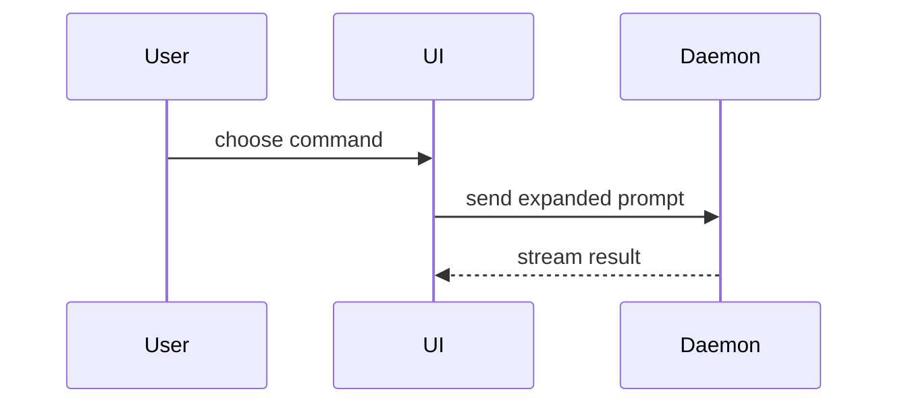

用这个模板写 PR 正文：

```markdown
## 概述

<图示、diff 草图或结构树>

## 证据

- **之前：** <截图/输出/失败的测试运行>
  **之后：** <截图/输出/通过的测试运行>

## 合并风险

**门的类型：** <单向门或双向门>

<可选：说明>

**影响半径：** <一个词描述>

<可选：合并可能带来的后果>
```

## 各节写法

跳过所有开场白，正文尽量短。使用 `GLOSSARY.md` 里的领域语言。

### 概述

选择能说清关键点的**最小视图**。

- 用伪代码展示逻辑或算法：

```text
on(save)
  if content is unchanged
    return cached result
  write new content
  return fresh result
```

- 用调用树展示运行时控制流：

```text
submitForm
  createSession
    persistPrompt
    launchAgent
  navigateToSession
```

- 用组件树展示 UI 结构，包含重要的状态与模块边界：

```text
<SessionPage> (apps/example/src/routes/session.tsx)
  useSessionEvents()
  <SessionToolbar>
    <RunSkillButton> (packages/ui)
```

- 用浅层文件树展示文件职责或大范围重构：

```text
src/
├── commands/       # 解析用户动作
├── sessions/       # 拥有会话状态
└── transport/      # 发送 API 请求
```

- 用 Mermaid 展示组件交互、控制流或数据流：



- 当重点是“改了什么”且周边形状已经存在时，用 `diff`。diff 的形态要匹配主题。

组件改动：

```diff
 <SessionPage>
   useSessionEvents()
   <SessionToolbar>
+    <RunSkillButton />
   <SessionTimeline>
+    <SkillResultCard />
```

文件布局改动：

```diff
 src/
 ├── commands/
+│   └── show-me.ts       # expands the slash command
 ├── sessions/
-└── transport.ts
+└── transport/
+    ├── client.ts
+    └── stream.ts
```

调用树或调用栈改动：

```diff
 submitForm
   createSession
     persistPrompt
+    expandSkillMention
     launchAgent
-  navigateToSession
+  navigateToSession
+    subscribeToEvents
```

状态或控制流改动：

```diff
 on(save)
-  write content
+  if content is unchanged
+    return cached result
+  write new content
+  invalidate cache
```

- 当大部分内容都是新的、省略上下文会隐藏归属或顺序、或用户需要一个可复制的目标形状时，展示完整块：

```ts
function expandSkill(command: string): string {
  const skillName = command.slice(1);
  return `use the ${skillName} skill`;
}
```

#### 指导原则

每个图示都紧挨着它所支撑的那段短文字。只保留回答当前问题、或解决当前讨论点所需的选择项、调用、文件、props、状态与边界。

可以只用一种，也可以用几种；通常不会全用。自己判断，别把用户淹没。

### 证据

能证明改动确实有效的具体证据。给出之前与之后。

截图是 S 级——前提是环境支持且改动是视觉性的。

基于执行的证据是 A 级。测试结果、控制台输出。用伪代码展示那条现在失败、修好后通过的测试。

### 合并风险

说明这是单向门还是双向门。双向门可以走回去，单向门不行。回滚成本低的 PR 风险更低。涉及破坏性操作或难以回退的决策，就是单向门。

影响半径是本 PR 引入改动的潜在影响或范围。要考虑所有可能性，例如布局抖动、破坏下游消费者、移动端适配等。
